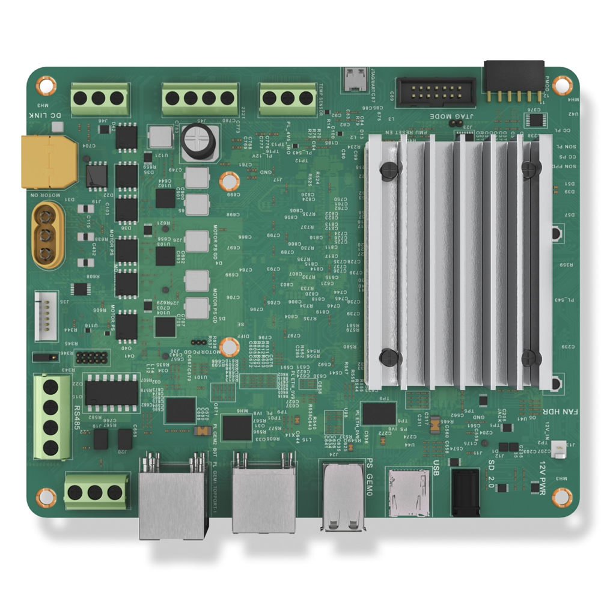
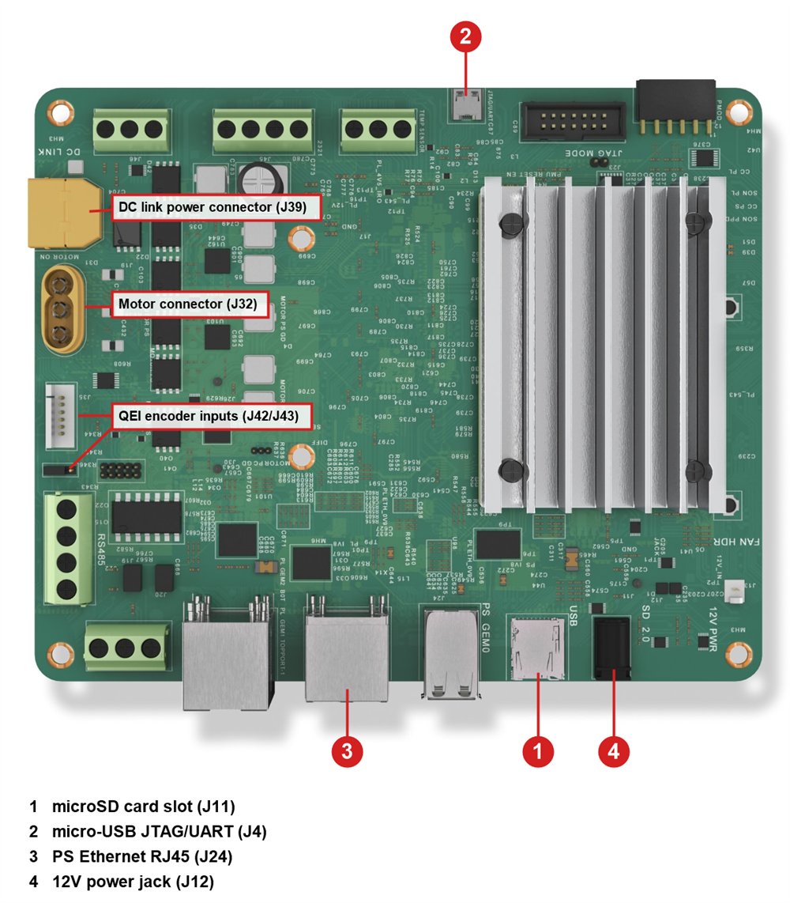

# AMD Kria KD240 Drives Starter Kit QuickStart

[Purchase the AMD Kria KD240 Drives Starter Kit](https://www.newark.com/amd/sk-kd240-g/starter-kit-zynq-ultrascale-mpsoc/dp/83AK4855)

1. [Introduction](#1-introduction)
2. [Requirements](#2-requirements)
3. [Linux Image Flashing](#3-linux-image-flashing)
4. [Hardware Setup](#4-hardware-setup)
5. [Device Setup](#5-device-setup)
6. [Onboard Device](#6-onboard-device)
7. [Using the Demo](#7-using-the-demo)
8. [Going Further: Expansion Demos](#8-going-further-expansion-demos)
9. [Resources](#9-resources)

# 1. Introduction

This guide walks through the steps to connect the AMD Kria KD240 Drives Starter Kit to the Avnet IOTCONNECT platform
and demonstrate the standard IoT function of telemetry collection.

<!-- TODO: photo needed: kd240-product.png (product shot of the KD240 kit) -->
<table>
  <tr>
    <td></td>
    <td>The Kria KD240 Drives Starter Kit pairs the AMD K24 System-on-Module (Zynq UltraScale+ MPSoC with a quad-core
Arm Cortex-A53 and FPGA programmable logic) with a motor-drive carrier card: a three-phase inverter motor output,
quadrature encoder (QEI) inputs, torque sensor and brake interfaces, CAN, RS-485, 1-Wire, one processing-system
Gigabit Ethernet port plus two programmable-logic Ethernet ports with TSN and EtherCAT support, and two USB 3.0 ports.
The KD240 is a headless board: it has no display output, and all interaction is through the serial console or SSH.
The power supply is included in the box.</td>
  </tr>
</table>

# 2. Requirements

## Hardware

* AMD Kria KD240 Drives Starter Kit (SK-KD240-G) [Purchase](https://www.newark.com/amd/sk-kd240-g/starter-kit-zynq-ultrascale-mpsoc/dp/83AK4855) | [User Guide](https://docs.amd.com/r/en-US/ug1093-kd240-starter-kit) | [All Resources](https://www.amd.com/en/products/system-on-modules/kria/k24/kd240-drives-starter-kit.html)

The SK-KD240-G box includes the 12V/3A power supply, a USB-A to micro-B cable, and a 16GB microSD card, so no
separately sold accessories are required for this quickstart. You still need:

* Ethernet cable (and a local router/switch with Internet connectivity)
* A host PC with a microSD card slot or USB adapter for image flashing
* (Optional) [Kria KD240 Motor Accessory Pack (HW-MACCP01-SK-G)](https://www.amd.com/en/products/system-on-modules/kria/k24/kd240-drives-starter-kit/kd240-motor-accessory-pack.html),
  for the planned motor control expansion demo. It contains a 24V Anaheim Automation BLDC motor with encoder, encoder
  and motor cables, a 24V motor power supply with XT60 adapter cable, an assembly plate, and a load disk.

## Software

* A serial terminal such as [TeraTerm](https://github.com/TeraTermProject/teraterm/releases)
  or [PuTTY](https://www.putty.org/)
* [Balena Etcher](https://etcher.balena.io/) (or Raspberry Pi Imager) for image flashing

# 3. Linux Image Flashing

1. Download the official Canonical Ubuntu image for Kria starter kits from [ubuntu.com/download/amd](https://ubuntu.com/download/amd):
   select **Ubuntu Server 24.04 LTS** (file `iot-limerick-kria-classic-server-2404-classic-24.04-x07-20250423.img.xz`
   at the time of writing; the same image serves the KV260, KR260, and KD240, and it is listed under the K24 SOM
   section for the KD240).
2. Flash the image to the included microSD card using Balena Etcher (the `.img.xz` file can be flashed directly, no
   need to decompress first).

## Boot Firmware

The KD240 uses the K24 boot firmware line, which is tracked separately from the K26 firmware used by the KV260 and
KR260. AMD publishes no hard minimum K24 firmware version for the Ubuntu 24.04 image; the official guide states the
image boots on factory firmware in the majority of cases and recommends updating to the latest firmware afterward for
best compatibility.

* Once Ubuntu is running, check your firmware with `sudo xmutil bootfw_status`. To update, follow the
  [Kria SOM Boot Firmware Update wiki page](https://xilinx-wiki.atlassian.net/wiki/spaces/A/pages/3020685316/Kria+SOM+Boot+Firmware+Update):
  download the latest K24 (KD240) `BOOT.BIN`, run `sudo xmutil bootfw_update -i <path to BOOT.BIN>`, reboot, and
  immediately run `sudo xmutil bootfw_update -v` to validate the new image. If you skip the validation step, the board
  falls back to the previous firmware on the next reboot. Do the firmware update before running `sudo apt upgrade`;
  that is the order the official AMD guide uses.
* If the board will not boot at all, use the Boot Image Recovery Tool described on the same wiki page: hold the FWUEN
  button while applying power, connect your PC to Ethernet port J24 with a static IP on the 192.168.0.x subnet, and
  browse to `http://192.168.0.111`. On the KD240, only port J24 works for recovery.

# 4. Hardware Setup

See the reference image below for cable connections.
<!-- TODO: photo needed: kd240-connections.png (top-down shot with power J12, micro-USB J4, PS Ethernet J24, and microSD J11 labeled) -->
<details>
<summary>Reference Image with Connections</summary>

</details>

1. Insert the flashed microSD card into the microSD card slot (J11).
2. Connect the micro-USB cable from your PC to the micro-USB connector (J4). This is the JTAG/UART interface and
   provides the serial console. The KD240 has no display output, so the serial console is the only way to interact
   with the board until the network is up.
3. Connect an Ethernet cable from your router/switch to the PS Ethernet port (J24). The other two RJ45 ports
   (J25A, J25B) are wired to the programmable logic for TSN/EtherCAT and do not work until a PL design is loaded.
4. Connect the included 12V/3A power supply to the DC jack (J12) **last**.

> [!NOTE]
> The KD240 has no power button; the board powers on as soon as the power supply is connected. To power down later,
> run `sudo shutdown -h now` before unplugging, so the microSD card is not corrupted.

The motor connections are not needed for this quickstart. For the planned motor control expansion demo, the Motor
Accessory Pack connects as follows: the BLDC motor's three phase wires to the motor connector (J32), the quadrature
encoder cable to the QEI input (J42 single-ended or J43 differential, selected by jumper J44), and the 24V motor
power supply to the DC link connector via the XT60 adapter cable.

<!-- TODO: verify on hardware: UG1093 names the DC link connector J39, but the AMD FOC app guide says J29; check the board silkscreen before documenting the motor hookup. -->
<!-- TODO: photo needed (later, for the motor demo): kd240-motor-connections.png (motor pack wired to J32, QEI, and DC link) -->

# 5. Device Setup

1. With the micro-USB cable connected and the board powered, open your Device Manager list. The KD240's FTDI chip
   enumerates **four** COM ports; the serial console is the **second** of the four numbered ports. If no COM ports
   appear, install the [FTDI VCP driver](https://ftdichip.com/drivers/vcp-drivers/).
2. Open a terminal emulator program such as TeraTerm or PuTTY on your host machine.
3. Ensure that your serial settings in your terminal emulator are set to:

- Baud Rate: 115200
- Data Bits: 8
- Stop Bits: 1
- Parity: None
- Flow Control: None

4. Connect to the COM port from sub-step 1. Press ENTER if the window is blank; you should see a login prompt once
   the board finishes booting (the first boot can take a couple of minutes).
5. Log in with username `ubuntu` and password `ubuntu`. The system forces a password change on first login: enter the
   current password `ubuntu` again, then your new password twice. Note the new password somewhere safe.
6. Run these commands to update the package index and install the necessary IOTCONNECT packages:

```
sudo apt-get update
```

```
sudo apt-get install -y python3-pip
```

```
python3 -m pip install iotconnect-sdk-lite requests --break-system-packages
```

> [!NOTE]
> Ubuntu 24.04 marks the system Python as externally managed (PEP 668), so the `--break-system-packages` flag is
> required for a system-wide pip install.

7. Run this command to create and move into a directory for your demo files:

```
sudo mkdir -p /opt/demo && cd /opt/demo
```

8. Run this command to ensure your user has ownership of the new directory:

```
sudo chown -R ubuntu:ubuntu /opt/demo
```

> [!TIP]
> SSH is enabled by default on the Kria Ubuntu image. After the first-boot password change, you can find the board's
> IP address with `ip -br a` and connect from your host PC with `ssh ubuntu@x.x.x.x` instead of using the serial
> console. To gain access to "copy" and "paste" functions inside of a PuTTY terminal window, you can CTRL+RIGHTCLICK
> within the window to utilize a dropdown menu with these commands.

# 6. Onboard Device

The next step is to onboard your device into IOTCONNECT. This will be done via the online IOTCONNECT user interface.

Follow [this guide](../common/general-guides/UI-ONBOARD.md) to walk you through the process.

# 7. Using the Demo

Run the basic demo with this command:

```
python3 app.py
```

> [!NOTE]
> Always make sure you are in the ```/opt/demo``` directory before running the demo. You can move to this
> directory with the command: ```cd /opt/demo```

View the random-integer telemetry data under the "Live Data" tab for your device on IOTCONNECT.

# 8. Going Further: Expansion Demos

Expansion demos for the Kria starter kits are planned and tracked in [PLAN-KRIA.md](../PLAN-KRIA.md) at the root of
this repository:

* **Kria System and Accelerator Monitor**: streams CPU, memory, SOM temperature, and SOM power telemetry, reports the
  currently loaded programmable logic (PL) accelerator app, and switches accelerator apps through cloud commands.
* **KD240 Motor Control Demo**: field-oriented control of the Motor Accessory Pack BLDC motor using AMD's FOC Motor
  Control app and its Python interface, streaming speed, current, position, and fault telemetry with set-speed,
  set-mode, and stop commands from the cloud.

# 9. Resources

* [Purchase the AMD Kria KD240 Drives Starter Kit (Newark)](https://www.newark.com/amd/sk-kd240-g/starter-kit-zynq-ultrascale-mpsoc/dp/83AK4855)
* [Purchase the AMD Kria KD240 Drives Starter Kit (Avnet)](https://www.avnet.com/americas/product/amd/sk-kd240-g/evolve-66433367/)
* [Purchase the KD240 Motor Accessory Pack (Avnet)](https://www.avnet.com/americas/product/amd/hw-maccp01-sk-g/evolve-66840924)
* [KD240 Product Page](https://www.amd.com/en/products/system-on-modules/kria/k24/kd240-drives-starter-kit.html)
* [KD240 User Guide (UG1093)](https://docs.amd.com/r/en-US/ug1093-kd240-starter-kit)
* [KD240 Data Sheet (DS984)](https://docs.amd.com/r/en-US/ds984-kd240-starter-kit)
* [Ubuntu for AMD Kria download page](https://ubuntu.com/download/amd)
* [AMD KD240 Ubuntu 24.04 Boot Guide](https://xilinx.github.io/kria-apps-docs/kd240/linux_boot/ubuntu_24_04/build/html/docs/intro.html)
* [AMD Kria Wiki: Kria SOMs and Starter Kits](https://xilinx-wiki.atlassian.net/wiki/spaces/A/pages/1641152513/Kria+SOMs+Starter+Kits)
* [AMD Kria Wiki: Boot Firmware Update](https://xilinx-wiki.atlassian.net/wiki/spaces/A/pages/3020685316/Kria+SOM+Boot+Firmware+Update)
* [/IOTCONNECT Overview](https://www.iotconnect.io/)
* [/IOTCONNECT Knowledgebase](https://help.iotconnect.io/)
