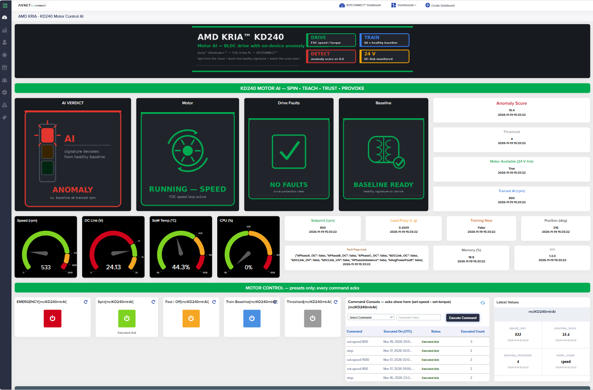

# KD240 Motor Control and Edge AI Anomaly Detection Expansion Demo

Upgrades the /IOTCONNECT Starter Demo on the AMD Kria KD240 to a cloud-connected motor drive with embedded AI:
field-oriented control (FOC) of the Motor Accessory Pack BLDC motor through AMD's FOC Motor Control app, plus an
on-device anomaly model that learns the motor's healthy electrical signature and flags deviations in real time.
A ready-made IOTCONNECT dashboard (section 7) drives the whole experience with preset buttons:



> [!IMPORTANT]
> Complete the [/IOTCONNECT quickstart guide for the KD240](../README.md) before proceeding. The
> [Kria KD240 Motor Accessory Pack (HW-MACCP01-SK-G)](https://www.amd.com/en/products/system-on-modules/kria/k24/kd240-drives-starter-kit/kd240-motor-accessory-pack.html)
> is required.

## 1. Introduction

The demo drives the accessory pack's 24V Anaheim Automation BLDC motor through the programmable-logic FOC pipeline of
AMD's [FOC Motor Control app 0.5](https://xilinx.github.io/kria-apps-docs/kd240/foc-motor-ctrl/0_5/build/html/docs/app_deployment.html)
(the Kria accelerated app released for Ubuntu 24.04) using its Python bindings. Speed, rotor position, per-phase
currents, FOC-frame currents, DC link voltage, and the drive's eight fault flags stream to IOTCONNECT every 5
seconds, and cloud commands set the speed, torque, and mode.

The embedded AI part runs entirely on the board: the `train-baseline` command samples the running motor at 1 Hz and
fits a robust statistical model (per-feature median and MAD) of its healthy signature over five features: speed
error, FOC torque current (Iq), FOC flux current (Id), phase-current imbalance, and DC link voltage. Afterward every
sample is scored as a robust z-score against that baseline; mechanical load changes, phase problems, and supply
droop move the score, and crossing the threshold raises the `anomaly` flag in telemetry. No cloud round trip, no
extra packages, no GPU: condition monitoring as it is actually deployed on drives.

## 2. Hardware Setup

Wire the Motor Accessory Pack per the
[official deployment guide](https://xilinx.github.io/kria-apps-docs/kd240/foc-motor-ctrl/0_5/build/html/docs/app_deployment.html):

1. Mount the motor to the assembly plate with the load disk fitted.
2. Connect the motor's three phase wires to the motor connector (J32).
3. Connect the encoder cable to the QEI input: J42 (single-ended) or J43 (differential), selected by jumper J44.
4. Connect the 24V motor power supply to the DC link connector through the XT60 adapter cable. UG1093 labels the DC
   link connector J39 while the FOC app guide calls it J29; it is the yellow XT60-style connector next to the
   DC LINK silkscreen on the board's top-left edge.

> [!WARNING]
> The motor spins. Keep the assembly on a stable surface, keep fingers and cables away from the load disk, and keep
> the `stop` command handy. The motor stack refuses to initialize until the 24V DC link is powered.

## 3. Install the AMD FOC Motor Control Stack (one time)

On the board, add the repositories:

```bash
sudo add-apt-repository -y ppa:xilinx-apps
sudo add-apt-repository -y ppa:ubuntu-xilinx/default
sudo add-apt-repository -y ppa:lely/ppa
sudo apt-get update
```

> [!IMPORTANT]
> On Ubuntu 24.04 the firmware package depends on `motor-control-iio-modules`, which AMD has not published as a
> package for noble; it only exists as DKMS driver source on GitHub, so a direct
> `apt install xlnx-firmware-kd240-motor-ctrl-qei` fails with "motor-control-iio-modules is not installable".
> Build the driver package once from AMD's source first:

```bash
sudo apt-get install -y dkms dh-dkms build-essential debhelper git fakeroot "linux-headers-$(uname -r)"
git clone https://github.com/Xilinx/motor-control-iio-modules /tmp/mcim
cd /tmp/mcim && dpkg-buildpackage -us -uc -b
sudo apt-get install -y /tmp/motor-control-iio-modules_*.deb
```

Then install the FOC firmware and application packages:

```bash
sudo apt-get install -y xlnx-firmware-kd240-motor-ctrl-qei xlnx-app-kd240-foc-motor-ctrl
```

Load the motor-control PL firmware (and make it the loaded app after every boot, or re-run the loadapp command):

```bash
sudo xmutil unloadapp
sudo xmutil loadapp kd240-motor-ctrl-qei
```

Motor parameters come from `/etc/motor-control/config`, which the package points at the accessory pack's
`anaheim.config` by default.

> [!NOTE]
> AMD's own Bokeh dashboard (`start_motor_dashboard`, port 3006) uses the same singleton motor interface; do not run
> it and this demo at the same time.

## 4. Change Device Template

Change your device's template to `kd24MC` in the IOTCONNECT online platform (import
[kd24MC-template.json](kd24MC-template.json) via **Templates, Create Template, Import** if needed), the same way the
other expansion demos do.

## 5. Download and Install

On the board, run:

```bash
cd /opt/demo
wget -O package.tar.gz TODO-downloads.iotconnect.io-package-url
tar -xzf package.tar.gz --overwrite
sudo bash ./install.sh
```

Running `install.sh` with sudo installs the Python dependencies system wide, so they are importable by root, which
is how the demo runs (see section 6). It also installs and enables the `iotc-motor-ai` systemd service, so from
then on the demo starts by itself whenever the board powers up: at boot the service waits for dfx-mgr, loads the
`kd240-motor-ctrl-qei` firmware if it is not already loaded (`motor-firmware-load.sh`), and starts `app.py` as
root with the motor stopped. Useful commands:

```bash
sudo systemctl status iotc-motor-ai        # state
sudo journalctl -u iotc-motor-ai -f        # live log
sudo systemctl stop iotc-motor-ai          # stop (also stops the motor)
sudo systemctl disable iotc-motor-ai       # stop starting at boot
```

> [!NOTE]
> TODO: the package will be hosted on downloads.iotconnect.io; until then, build it yourself with the steps in
> section 8 and copy it to the board.

## 6. Using the Demo

After install the demo runs as the `iotc-motor-ai` service and starts on every boot, so normally there is nothing
to launch. To run it by hand instead (stop the service first so two instances never share the motor), note that
the FOC library programs the drive hardware through IIO and UIO device nodes that only root can access (AMD's own
dashboard runs the same way), so run it with sudo:

```bash
sudo systemctl stop iotc-motor-ai
cd /opt/demo
sudo python3 app.py
```

Local smoke tests that do not need IOTCONNECT onboarding:

```bash
sudo python3 app.py --dry-run          # one telemetry sample, no motor motion; also verifies the 24V DC link
sudo python3 app.py --spin-test 600    # spin at 600 rpm for 5 seconds, print readings, stop
```

Typical cloud workflow:

1. `set-speed 800` starts the motor in speed mode (0 stops; magnitude 250 to 10000 rpm).
2. Let it settle about 30 seconds, then `train-baseline` (optional parameter: window in seconds, default 60).
   Telemetry shows `baseline_training` true while the window is open, then `baseline_ready` true.
3. Watch `anomaly_score` sit low on the healthy motor. The model reacts to changes in the electrical signature:
   added mechanical load on the load disk, a sagging 24V supply, or phase problems. A no-load setpoint change barely
   moves the signature and scores low (verified on hardware), which is the honest behavior for a condition monitor.
   For a quick hands-off demonstration, send `stop` while watching Live Data: during the coast-down the signature
   deviates hard from the baseline (score above 40 in hardware validation) and the `anomaly` flag raises.
4. `stop` halts the motor; `clear-faults` resets latched drive faults (the drive forces mode off).

The baseline is per operating point: after deliberately changing the speed setpoint, retrain to make the new
operating point the healthy reference. The baseline persists in `/opt/demo/baseline.json` across restarts.

> [!NOTE]
> With the accessory pack motor and the stock `anaheim.config`, the measured speed settles noticeably below the
> setpoint (for example about 590 rpm at an 800 rpm setpoint in our validation). The demo reports both
> `speed_setpoint_rpm` and `speed_rpm` so the dashboard shows the real tracking behavior.

Telemetry attributes and commands are listed in [kd24MC-template.json](kd24MC-template.json); the table mirrors the
other Kria expansion demos (system telemetry plus the motor and anomaly attributes above).

## 7. Import the Dashboard

The dashboard pictured at the top of this page ships with the demo as
[kd24MC-dashboard-export.json](kd24MC-dashboard-export.json): AI verdict and motor status tiles, speed/DC-link/
temperature gauges, anomaly score with threshold, preset command buttons (emergency stop, spin, train baseline,
threshold), and a command console that shows every acknowledgement.

To import it into your IOTCONNECT instance:

1. Download [kd24MC-dashboard-export.json](kd24MC-dashboard-export.json) to your PC.
2. In the IOTCONNECT web UI, open **Dashboards** and choose **Create Dashboard**.
3. Select the **Import Dashboard** option, browse to the downloaded JSON file, and give the dashboard a name.
4. When prompted for the data source, select the `kd24MC` template and your device (for example `mclKD240mtrAI`),
   then save.
5. Open the dashboard; tiles populate within one 5 second telemetry cycle, and the preset buttons in the bottom
   row drive the motor demo end to end.

## 8. How It Works

* Motor control uses the `py_foc_motor_ctrl` pybind11 bindings from `xlnx-app-kd240-foc-motor-ctrl`
  ([Xilinx/foc-motor-ctrl](https://github.com/Xilinx/foc-motor-ctrl)): `MotorControl.getMotorControlInstance()`,
  `setOperationMode(kModeSpeed | kModeTorque | kModeOff)`, `setSpeed`, `setTorque`, with readbacks via `getSpeed`,
  `getPosition`, `getCurrent`, `getVoltage`, `getFocCalc`, and `getFaultStatus`. The app re-execs itself once at
  startup to add the app's `lib/` directory to `PYTHONPATH` and `LD_LIBRARY_PATH`, so a plain `python3 app.py` works.
* The FOC algorithm itself runs in the programmable logic (AMD Vitis Motor Control library HLS IP); the CPU only
  supervises, samples, and scores.
* The anomaly model is deliberately simple and robust: median/MAD per feature, score = max robust z-score. It is a
  one-class novelty detector in the same family as classical condition-monitoring methods, it trains in a minute on
  the device, and its verdicts are explainable by looking at which feature moved.

## 9. Customize and Rebuild (Optional)

1. Clone the repository to your host machine:
   ```bash
   git clone https://github.com/avnet-iotconnect/iotc-python-lite-sdk-demos.git
   ```

2. Edit files in `amd-kria-kd240/motor-ai-demo/src/` as needed.

3. Rebuild the package:
   ```bash
   cd amd-kria-kd240/motor-ai-demo
   bash ./create-package.sh
   ```

4. Deliver the new package to the board with scp, or publish it as OTA firmware for the `kd24MC` template the same
   way the [system monitor demo README](../system-monitor-demo/README.md) describes.

## 10. Community Guides

Hackster.io projects that go deeper into the same hardware, useful after this demo whets your appetite:

* [Getting Started with BLDCs on Kria KD240 + Motor Kit Part 1](https://www.hackster.io/whitney-knitter/getting-started-with-bldcs-on-kria-kd240-motor-kit-part-1-c18318)
  by Whitney Knitter: the basics of controlling the Motor Accessory Pack BLDC yourself with a custom Vivado design,
  rather than through AMD's prebuilt FOC app.
* [Getting Started with BLDCs on Kria KD240 + Motor Kit Part 2](https://www.hackster.io/whitney-knitter/getting-started-with-bldcs-on-kria-kd240-motor-kit-part-2-fb5ee0)
  by Whitney Knitter: continues the series by reading back-EMF data through a custom accelerated kernel loaded with
  `xmutil`, the same app-loading mechanism this demo's firmware uses.
* [K24 SoM eMMC/SD Programming with KD240 and Custom Carrier](https://www.hackster.io/LogicTronix/k24-som-emmc-sd-programming-with-kd240-and-custom-carrier-322d09)
  by LogicTronix: booting PetaLinux from the K24 SOM's eMMC with bootloaders in QSPI, including why the KD240's SD
  card appears as a USB disk (it sits behind the onboard USB hub, unlike the KV260).
