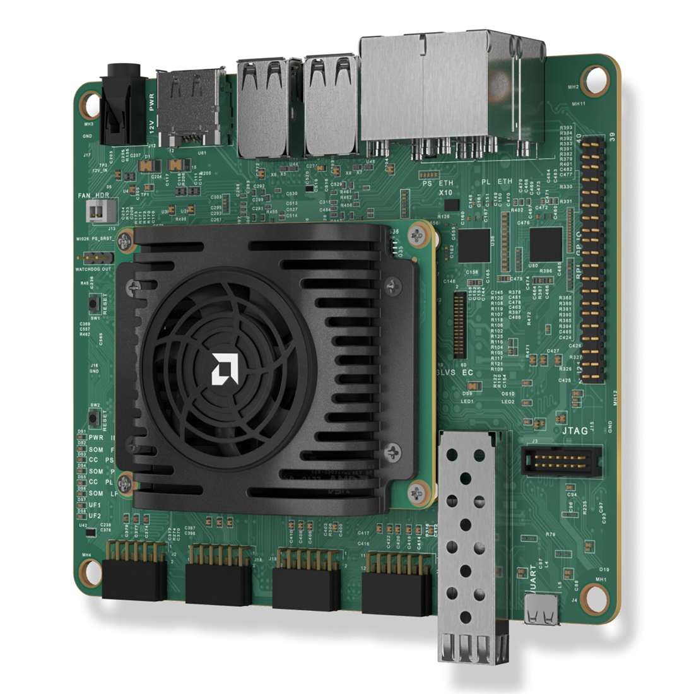
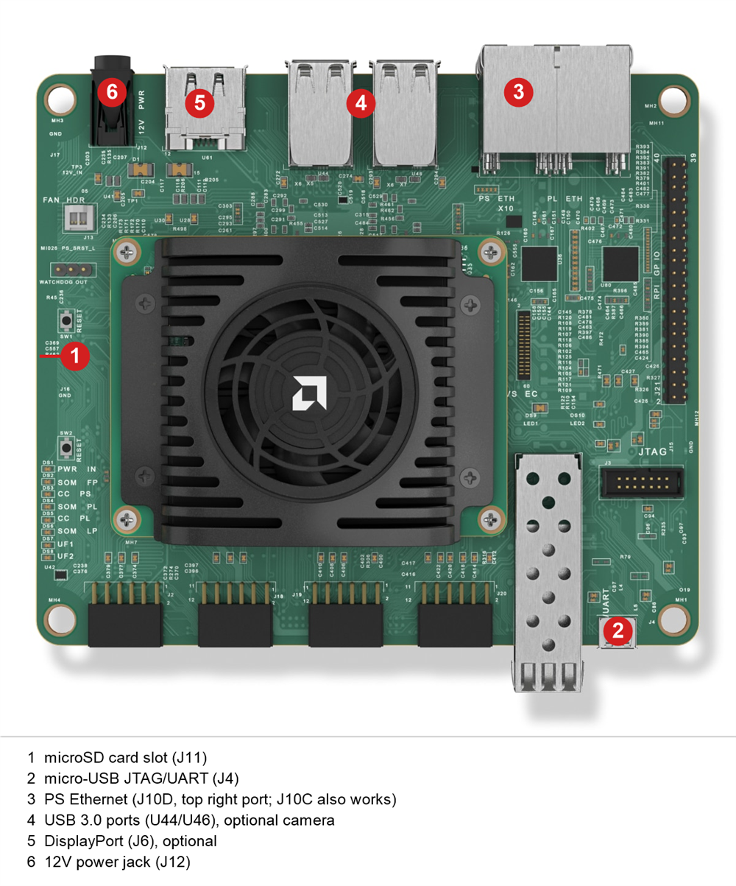

# AMD Kria KR260 Robotics Starter Kit QuickStart

[Purchase the AMD Kria KR260 Robotics Starter Kit](https://www.newark.com/amd/sk-kr260-g/starter-kit-robotics-mpsoc/dp/33AK7080)

1. [Introduction](#1-introduction)
2. [Requirements](#2-requirements)
3. [Linux Image Flashing](#3-linux-image-flashing)
4. [Hardware Setup](#4-hardware-setup)
5. [Device Setup](#5-device-setup)
6. [Onboard Device](#6-onboard-device)
7. [Using the Demo](#7-using-the-demo)
8. [Going Further: Expansion Demos](#8-going-further-expansion-demos)
9. [Resources](#9-resources)

# 1. Introduction

This guide walks through the steps to connect the AMD Kria KR260 Robotics Starter Kit to the Avnet IOTCONNECT platform
and demonstrate the standard IoT function of telemetry collection.

<!-- TODO: photo needed: kr260-product.png (product shot of the KR260 kit) -->
<table>
  <tr>
    <td></td>
    <td>The Kria KR260 Robotics Starter Kit pairs the AMD K26 System-on-Module (Zynq UltraScale+ MPSoC with a
quad-core Arm Cortex-A53 and FPGA programmable logic, 4GB DDR4) with a robotics-focused carrier card: four Gigabit
Ethernet ports (two wired to the processing system, two to the programmable logic with TSN support), an SFP+ cage,
four USB 3.0 ports, four Pmod expansion headers, and DisplayPort output. Unlike the KV260, the power supply is
included in the box. This guide was validated on a KR260 (rev B) running boot firmware K26-BootFW-01.02 and
Ubuntu 24.04.2 LTS.</td>
  </tr>
</table>

# 2. Requirements

## Hardware

* AMD Kria KR260 Robotics Starter Kit (SK-KR260-G) [Purchase](https://www.newark.com/amd/sk-kr260-g/starter-kit-robotics-mpsoc/dp/33AK7080) | [User Guide](https://docs.amd.com/r/en-US/ug1092-kr260-starter-kit) | [All Resources](https://www.amd.com/en/products/system-on-modules/kria/k26/kr260-robotics-starter-kit.html)

The SK-KR260-G box includes the 12V/3A power supply, a USB-A to micro-B cable, and a microSD card with SD adapter, so
no separately sold accessories are required. You still need:

* Ethernet cable (and a local router/switch with Internet connectivity)
* A host PC with a microSD card slot or USB adapter for image flashing
* (Optional) USB3 camera, for the planned inspection cell expansion demo
* (Optional) DisplayPort monitor; this guide uses the serial console, so a monitor is not required

## Software

* A serial terminal such as [TeraTerm](https://github.com/TeraTermProject/teraterm/releases)
  or [PuTTY](https://www.putty.org/)
* [Balena Etcher](https://etcher.balena.io/) (or Raspberry Pi Imager) for image flashing

# 3. Linux Image Flashing

1. Download the official Canonical Ubuntu image for Kria starter kits from [ubuntu.com/download/amd](https://ubuntu.com/download/amd):
   select **Ubuntu Server 24.04 LTS** for the K26 SOMs (file `iot-limerick-kria-classic-server-2404-classic-24.04-x07-20250423.img.xz`
   at the time of writing). The same image serves the KV260, KR260, and KD240.
2. Flash the image to the included microSD card using Balena Etcher (the `.img.xz` file can be flashed directly, no
   need to decompress first).

## Boot Firmware

The Ubuntu 24.04 image requires Kria K26 boot firmware version 01.02 or later. KR260 kits ship from the factory with
01.02 or later, so most boards boot the 24.04 image out of the box; this was confirmed on the board used to validate
this guide (factory K26-BootFW-01.02).

* Once Ubuntu is running, check your firmware with `sudo xmutil bootfw_status`. To update to the latest version,
  follow the [Kria SOM Boot Firmware Update wiki page](https://xilinx-wiki.atlassian.net/wiki/spaces/A/pages/3020685316/Kria+SOM+Boot+Firmware+Update):
  download the latest KR260 `BOOT.BIN`, run `sudo xmutil bootfw_update -i <path to BOOT.BIN>`, reboot, and immediately
  run `sudo xmutil bootfw_update -v` to validate the new image. If you skip the validation step, the board falls back
  to the previous firmware on the next reboot. Do the firmware update before running `sudo apt upgrade`; that is the
  order the official AMD guide uses.
* If the board will not boot at all, use the Boot Image Recovery Tool described on the same wiki page: hold the FWUEN
  button while applying power, connect your PC to Ethernet port J10C with a static IP on the 192.168.0.x subnet, and
  browse to `http://192.168.0.111`. On the KR260, only port J10C works for recovery.

# 4. Hardware Setup

See the reference image below for cable connections.
<!-- TODO: photo needed: kr260-connections.png (top-down shot with power J12, micro-USB J4, PS Ethernet ports J10C/J10D, and microSD J11 labeled) -->
<details>
<summary>Reference Image with Connections</summary>

</details>

1. Insert the flashed microSD card into the microSD card slot (J11).
2. Connect the micro-USB cable from your PC to the micro-USB connector (J4). This is the JTAG/UART interface and
   provides the serial console.
3. Connect an Ethernet cable from your router/switch to one of the two PS Ethernet ports: J10D (the top right port)
   or J10C. The other two RJ45 ports (J10A, J10B) are wired to the programmable logic and do not work until a PL
   design is loaded.
4. (Optional) Connect a USB3 camera to one of the USB ports (U44/U46). Not needed for this quickstart.
5. (Optional) Connect a DisplayPort monitor to J6. Not needed for this quickstart.
6. Connect the included 12V/3A power supply to the DC jack (J12) **last**.

> [!NOTE]
> The KR260 has no power button; the board powers on as soon as the power supply is connected. To power down later,
> run `sudo shutdown -h now` before unplugging, so the microSD card is not corrupted.

# 5. Device Setup

1. With the micro-USB cable connected and the board powered, open your Device Manager list. The KR260's FTDI chip
   enumerates **four** COM ports; the serial console is the **second** of the four numbered ports. If no COM ports
   appear, install the [FTDI VCP driver](https://ftdichip.com/drivers/vcp-drivers/).
2. Open a terminal emulator program such as TeraTerm or PuTTY on your host machine.
3. Ensure that your serial settings in your terminal emulator are set to:

- Baud Rate: 115200
- Data Bits: 8
- Stop Bits: 1
- Parity: None
- Flow Control: None

4. Connect to the COM port from sub-step 1. Press ENTER if the window is blank; you should see a `kria login:` prompt
   once the board finishes booting (the first boot can take a couple of minutes).
5. Log in with username `ubuntu` and password `ubuntu`. The system forces a password change on first login: enter the
   current password `ubuntu` again, then your new password twice. Note the new password somewhere safe.
6. Run these commands to update the package index and install the necessary IOTCONNECT packages:

```
sudo apt-get update
```

```
sudo apt-get install -y python3-pip
```

```
python3 -m pip install iotconnect-sdk-lite requests --break-system-packages
```

> [!NOTE]
> Ubuntu 24.04 marks the system Python as externally managed (PEP 668), so the `--break-system-packages` flag is
> required for a system-wide pip install.

7. Run this command to create and move into a directory for your demo files:

```
sudo mkdir -p /opt/demo && cd /opt/demo
```

8. Run this command to ensure your user has ownership of the new directory:

```
sudo chown -R ubuntu:ubuntu /opt/demo
```

> [!TIP]
> SSH is enabled by default on the Kria Ubuntu image. After the first-boot password change, you can find the board's
> IP address with `ip -br a` and connect from your host PC with `ssh ubuntu@x.x.x.x` instead of using the serial
> console. To gain access to "copy" and "paste" functions inside of a PuTTY terminal window, you can CTRL+RIGHTCLICK
> within the window to utilize a dropdown menu with these commands.

# 6. Onboard Device

The next step is to onboard your device into IOTCONNECT. This will be done via the online IOTCONNECT user interface.

Follow [this guide](../common/general-guides/UI-ONBOARD.md) to walk you through the process.

# 7. Using the Demo

Run the basic demo with this command:

```
python3 app.py
```

> [!NOTE]
> Always make sure you are in the ```/opt/demo``` directory before running the demo. You can move to this
> directory with the command: ```cd /opt/demo```

View the random-integer telemetry data under the "Live Data" tab for your device on IOTCONNECT.

# 8. Going Further: Expansion Demos

Expansion demos for the Kria starter kits are planned and tracked in [PLAN-KRIA.md](../PLAN-KRIA.md) at the root of
this repository:

* **Kria System and Accelerator Monitor**: streams CPU, memory, SOM temperature, and SOM power telemetry, reports the
  currently loaded programmable logic (PL) accelerator app, and switches accelerator apps through cloud commands.
* **KR260 Inspection Cell Demo**: USB3 camera inspection station reporting pass/fail results and cycle metrics, with
  an optional ROS 2 bridge node that maps ROS 2 topics to telemetry and IOTCONNECT commands to ROS 2 services.

# 9. Resources

* [Purchase the AMD Kria KR260 Robotics Starter Kit (Newark)](https://www.newark.com/amd/sk-kr260-g/starter-kit-robotics-mpsoc/dp/33AK7080)
* [Purchase the AMD Kria KR260 Robotics Starter Kit (Avnet)](https://www.avnet.com/americas/product/amd/sk-kr260-g/evolve-69330876/)
* [KR260 Product Page](https://www.amd.com/en/products/system-on-modules/kria/k26/kr260-robotics-starter-kit.html)
* [KR260 User Guide (UG1092)](https://docs.amd.com/r/en-US/ug1092-kr260-starter-kit)
* [Ubuntu for AMD Kria download page](https://ubuntu.com/download/amd)
* [AMD KR260 Ubuntu 24.04 Boot Guide](https://xilinx.github.io/kria-apps-docs/kr260/linux_boot/ubuntu_24_04/build/html/docs/intro.html)
* [AMD Kria Wiki: Kria SOMs and Starter Kits](https://xilinx-wiki.atlassian.net/wiki/spaces/A/pages/1641152513/Kria+SOMs+Starter+Kits)
* [AMD Kria Wiki: Boot Firmware Update](https://xilinx-wiki.atlassian.net/wiki/spaces/A/pages/3020685316/Kria+SOM+Boot+Firmware+Update)
* [/IOTCONNECT Overview](https://www.iotconnect.io/)
* [/IOTCONNECT Knowledgebase](https://help.iotconnect.io/)
