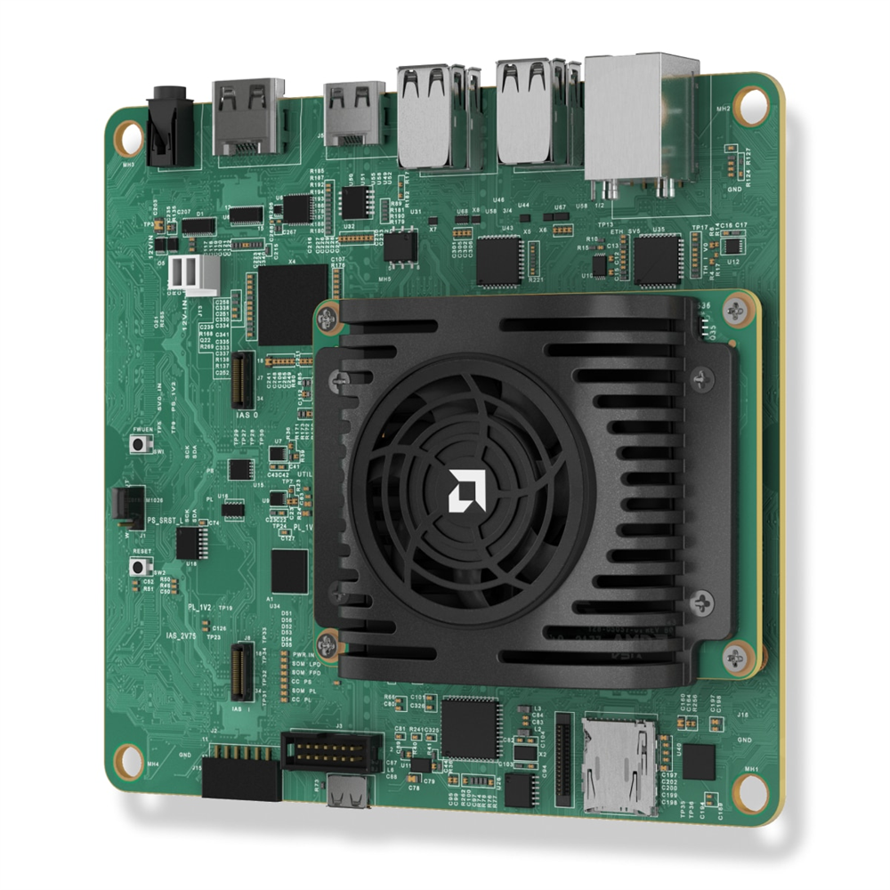
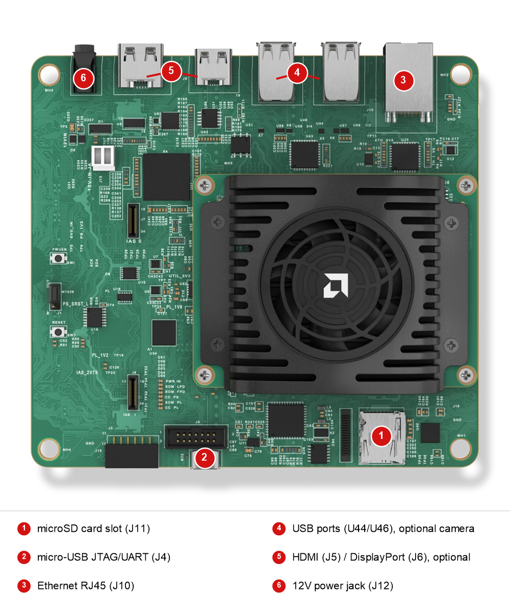

# AMD Kria KV260 Vision AI Starter Kit QuickStart

[Purchase the AMD Kria KV260 Vision AI Starter Kit](https://www.newark.com/amd/sk-kv260-g/vision-ai-startr-kit-arm-cortex/dp/26AM6575)

1. [Introduction](#1-introduction)
2. [Requirements](#2-requirements)
3. [Linux Image Flashing](#3-linux-image-flashing)
4. [Hardware Setup](#4-hardware-setup)
5. [Device Setup](#5-device-setup)
6. [Onboard Device](#6-onboard-device)
7. [Using the Demo](#7-using-the-demo)
8. [Going Further: Expansion Demos](#8-going-further-expansion-demos)
9. [Resources](#9-resources)

# 1. Introduction

This guide walks through the steps to connect the AMD Kria KV260 Vision AI Starter Kit to the Avnet IOTCONNECT platform
and demonstrate the standard IoT function of telemetry collection.

<!-- TODO: photo needed: kv260-product.png (product shot of the KV260 kit) -->
<table>
  <tr>
    <td></td>
    <td>The Kria KV260 Vision AI Starter Kit pairs the AMD K26 System-on-Module (Zynq UltraScale+ MPSoC with a
quad-core Arm Cortex-A53 and FPGA programmable logic, 4GB DDR4) with a carrier card built for vision applications:
two IAS camera connectors (one routed through an onsemi AP1302 ISP), a Raspberry Pi camera connector, four USB 3.0/2.0
ports, Gigabit Ethernet, HDMI 1.4, and DisplayPort 1.2a. The fan and heatsink come pre-assembled, and the kit runs
standard Ubuntu from a microSD card.</td>
  </tr>
</table>

# 2. Requirements

## Hardware

* AMD Kria KV260 Vision AI Starter Kit (SK-KV260-G) [Purchase](https://www.newark.com/amd/sk-kv260-g/vision-ai-startr-kit-arm-cortex/dp/26AM6575) | [User Guide](https://docs.amd.com/r/en-US/ug1089-kv260-starter-kit) | [All Resources](https://www.amd.com/en/products/system-on-modules/kria/k26/kv260-vision-starter-kit.html)
* 12V/3A power supply with a center-positive 2.5 mm ID / 5.5 mm OD barrel plug.

> [!IMPORTANT]
> The KV260 power supply is sold separately; it is not in the SK-KV260-G box. AMD offers it as the
> [Kria KV260 Power Supply and Adapter (HW-PSA01-SK-G)](https://www.amd.com/en/products/system-on-modules/kria/k26/kv260-vision-starter-kit/power-supply-adapter.html),
> or as part of the [Kria KV260 Basic Accessory Pack (HW-BACCP01-SK-G)](https://www.amd.com/en/products/system-on-modules/kria/k26/kv260-vision-starter-kit/basic-accessory-pack.html)
> which also includes a micro-USB cable, Ethernet cable, HDMI cable, microSD card, and a 13MP AR1335 IAS camera module.

* Micro-USB cable (must be a data cable; charge-only cables will not work)
* Ethernet cable (and a local router/switch with Internet connectivity)
* MicroSD card (16GB+) and hardware to connect the microSD card to your PC for image flashing
* (Optional) USB webcam or IAS camera module, for the planned vision expansion demo
* (Optional) HDMI or DisplayPort monitor; this guide uses the serial console, so a monitor is not required

## Software

* A serial terminal such as [TeraTerm](https://github.com/TeraTermProject/teraterm/releases)
  or [PuTTY](https://www.putty.org/)
* [Balena Etcher](https://etcher.balena.io/) (or Raspberry Pi Imager) for image flashing

# 3. Linux Image Flashing

1. Download the official Canonical Ubuntu image for Kria starter kits from [ubuntu.com/download/amd](https://ubuntu.com/download/amd):
   select **Ubuntu Server 24.04 LTS** for the K26 SOMs (file `iot-limerick-kria-classic-server-2404-classic-24.04-x07-20250423.img.xz`
   at the time of writing). The same image serves the KV260, KR260, and KD240.
2. Flash the image to your microSD card using Balena Etcher (the `.img.xz` file can be flashed directly, no need to
   decompress first).

## Boot Firmware

The Ubuntu 24.04 image requires Kria K26 boot firmware version 01.02 or later. Early KV260 kits shipped with legacy
2021.1 boot firmware that will not boot Ubuntu 22.04 or later images at all.

* Once Ubuntu is running, check your firmware with `sudo xmutil bootfw_status` (this reports the factory-installed
  version). Update by following the
  [Kria SOM Boot Firmware Update wiki page](https://xilinx-wiki.atlassian.net/wiki/spaces/A/pages/3020685316/Kria+SOM+Boot+Firmware+Update):
  download the latest KV260 `BOOT.BIN`, run `sudo xmutil bootfw_update -i <path to BOOT.BIN>`, reboot, and immediately
  run `sudo xmutil bootfw_update -v` to validate the new image. If you skip the validation step, the board falls back
  to the previous firmware on the next reboot. Do the firmware update before running `sudo apt upgrade`; that is the
  order the official AMD guide uses.
* If your board shows no sign of booting the 24.04 image (no serial output or a boot loop), it likely has the legacy
  2021.1 firmware. Use the Boot Image Recovery Tool described on the same wiki page: hold the FWUEN button while
  applying power, connect your PC to Ethernet port J10 with a static IP on the 192.168.0.x subnet, and browse to
  `http://192.168.0.111` to load the new firmware.

# 4. Hardware Setup

See the reference image below for cable connections.
<!-- TODO: photo needed: kv260-connections.png (top-down shot with power J12, micro-USB J4, Ethernet J10, microSD J11, and camera connectors J7/J9 labeled) -->
<details>
<summary>Reference Image with Connections</summary>

</details>

1. Insert the flashed microSD card into the microSD card slot (J11).
2. Connect the micro-USB cable from your PC to the micro-USB connector (J4). This is the JTAG/UART interface and
   provides the serial console.
3. Connect an Ethernet cable from your router/switch to the Ethernet connector (J10).
4. (Optional) Connect a USB webcam to one of the USB ports (U44/U46), or an IAS camera module to the ISP-connected
   IAS connector (J7). A Raspberry Pi camera can connect to J9. None of these are needed for this quickstart.
5. (Optional) Connect an HDMI monitor to J5 or a DisplayPort monitor to J6. Not needed for this quickstart.
6. Connect the 12V/3A power supply to the DC jack (J12) **last**.

> [!NOTE]
> The KV260 has no power button; the board powers on as soon as the power supply is connected. To power down later,
> run `sudo shutdown -h now` before unplugging, so the microSD card is not corrupted.

# 5. Device Setup

1. With the micro-USB cable connected and the board powered, open your Device Manager list. The KV260's FTDI chip
   enumerates **four** COM ports; the serial console is the **second** of the four numbered ports. If no COM ports
   appear, install the [FTDI VCP driver](https://ftdichip.com/drivers/vcp-drivers/).
2. Open a terminal emulator program such as TeraTerm or PuTTY on your host machine.
3. Ensure that your serial settings in your terminal emulator are set to:

- Baud Rate: 115200
- Data Bits: 8
- Stop Bits: 1
- Parity: None
- Flow Control: None

4. Connect to the COM port from sub-step 1. Press ENTER if the window is blank; you should see a login prompt once
   the board finishes booting (the first boot can take a couple of minutes).
5. Log in with username `ubuntu` and password `ubuntu`. The system forces a password change on first login: enter the
   current password `ubuntu` again, then your new password twice. Note the new password somewhere safe.
6. Run these commands to update the package index and install the necessary IOTCONNECT packages:

```
sudo apt-get update
```

```
sudo apt-get install -y python3-pip
```

```
python3 -m pip install iotconnect-sdk-lite requests --break-system-packages
```

> [!NOTE]
> Ubuntu 24.04 marks the system Python as externally managed (PEP 668), so the `--break-system-packages` flag is
> required for a system-wide pip install.

7. Run this command to create and move into a directory for your demo files:

```
sudo mkdir -p /opt/demo && cd /opt/demo
```

8. Run this command to ensure your user has ownership of the new directory:

```
sudo chown -R ubuntu:ubuntu /opt/demo
```

> [!TIP]
> SSH is enabled by default on the Kria Ubuntu image. After the first-boot password change, you can find the board's
> IP address with `ip -br a` and connect from your host PC with `ssh ubuntu@x.x.x.x` instead of using the serial
> console. To gain access to "copy" and "paste" functions inside of a PuTTY terminal window, you can CTRL+RIGHTCLICK
> within the window to utilize a dropdown menu with these commands.

# 6. Onboard Device

The next step is to onboard your device into IOTCONNECT. This will be done via the online IOTCONNECT user interface.

Follow [this guide](../common/general-guides/UI-ONBOARD.md) to walk you through the process.

# 7. Using the Demo

Run the basic demo with this command:

```
python3 app.py
```

> [!NOTE]
> Always make sure you are in the ```/opt/demo``` directory before running the demo. You can move to this
> directory with the command: ```cd /opt/demo```

View the random-integer telemetry data under the "Live Data" tab for your device on IOTCONNECT.

# 8. Going Further: Expansion Demos

Expansion demos for the Kria starter kits are planned and tracked in [PLAN-KRIA.md](../PLAN-KRIA.md) at the root of
this repository:

* **Kria System and Accelerator Monitor**: streams CPU, memory, SOM temperature, and SOM power telemetry, reports the
  currently loaded programmable logic (PL) accelerator app, and switches accelerator apps through cloud commands.
* **KV260 Vision AI Demo**: DPU-accelerated vision inference reporting detections, counts, FPS, and latency to
  IOTCONNECT, with over-the-air model swap.

# 9. Resources

* [Purchase the AMD Kria KV260 Vision AI Starter Kit (Newark)](https://www.newark.com/amd/sk-kv260-g/vision-ai-startr-kit-arm-cortex/dp/26AM6575)
* [Purchase the AMD Kria KV260 Vision AI Starter Kit (Avnet)](https://www.avnet.com/americas/product/amd/sk-kv260-g/evolve-53935148/)
* [KV260 Product Page](https://www.amd.com/en/products/system-on-modules/kria/k26/kv260-vision-starter-kit.html)
* [KV260 User Guide (UG1089)](https://docs.amd.com/r/en-US/ug1089-kv260-starter-kit)
* [KV260 Data Sheet (DS986)](https://docs.amd.com/r/en-US/ds986-kv260-starter-kit)
* [Ubuntu for AMD Kria download page](https://ubuntu.com/download/amd)
* [AMD KV260 Ubuntu 24.04 Boot Guide](https://xilinx.github.io/kria-apps-docs/kv260/2022.1/linux_boot/ubuntu_24_04/build/html/docs/intro.html)
* [AMD Kria Wiki: Kria SOMs and Starter Kits](https://xilinx-wiki.atlassian.net/wiki/spaces/A/pages/1641152513/Kria+SOMs+Starter+Kits)
* [AMD Kria Wiki: Boot Firmware Update](https://xilinx-wiki.atlassian.net/wiki/spaces/A/pages/3020685316/Kria+SOM+Boot+Firmware+Update)
* [/IOTCONNECT Overview](https://www.iotconnect.io/)
* [/IOTCONNECT Knowledgebase](https://help.iotconnect.io/)
